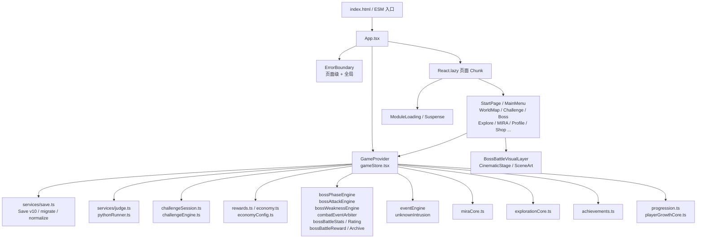

# NEXUS 技术架构说明

## 1. 总览

NEXUS 是纯前端单页游戏：

- React 18 + TypeScript。
- Vite 开发环境。
- 自定义 Rollup 生产构建。
- 无后端、无外部 AI API、无远程数据库。
- 本地 Python Runtime / Monaco / 存档。

## 2. 架构图

## 3. 前端

- `src/App.tsx`：screen 条件渲染；StartPage / MainMenu 常驻，其他页面 lazy。
- `src/pages/*`：页面 UI。
- `src/components/*`：Panel、Overlay、Loading、Error Boundary、Boss 视觉层。
- `public/*.css`：全局、Boss、菜单、世界地图、档案、剧情样式。

## 4. Game Store

- `src/store/gameStore.tsx`：中央组合根 / 事务层。
- 读取 Save，维护 `PlayerState`、screen、toast、全局事件。
- 所有跨系统写操作通过 `commitPlayer` 落在同一份 PlayerState。
- Boss / Challenge / Explore / MIRA / 成就 / 经济不各自保存第二份状态。

## 5. Save System

- `src/services/save.ts`
- `src/services/migrations.ts`
- SAVE_VERSION = 10。
- `normalizePlayerState` 字段级自愈：
  - 等级由 exp 重算。
  - 意识夹取 0–100。
  - 非法关卡/成就/碎片 ID 过滤。
  - 缺失 exploration / mira / ledger / boss 数据自动补齐。
- 损坏 JSON：备份原数据并安全重置。
- Boss 阶段运行与真实血量对齐。
- 所有新增字段可选，不升级存档版本。

## 6. Challenge System

- `challengeSession.ts`：会话、计数、结算。
- `challengeEngine.ts`：独立挑战状态机。
- `services/judge.ts`：构建测试 harness、执行、判题。
- `services/pythonRunner.ts`：本地 Python Runtime。
- 成功结算唯一源：`completeLevel`。
- 首通经验、星级、容错、贡献点、成就、MIRA 同事务写入。

## 7. Boss System

- `bossPhaseEngine.ts`：阶段、血量、转换、恢复。
- `bossAttackEngine.ts`：预警、攻击、防御、闪避、打断。
- `bossWeaknessEngine.ts`：线索、分析、破解、暴露、恢复。
- `combatEventArbiter.ts`：跨事件优先级与仲裁。
- `bossBattleStats.ts`：真实战斗统计。
- `bossBattleRating.ts`：评分。
- `bossBattleReward.ts`：奖励计算。
- `bossAchievementEngine.ts` / Store：Boss 成就。
- `bossBattleArchive.ts`：档案馆。
- `BossBattleVisualLayer.tsx`：攻击 / 阶段 / 弱点 / 危机 / 终端视觉。
- Boss Core 已冻结；F.3 只做页面级 lazy。

## 8. MIRA

- `src/game/miraCore.ts`：
  - 经验表、等级、阶段。
  - 6 个记忆定义。
  - `miraAward`：eventId 幂等。
  - `miraSceneLine`：场景冷却。
  - `miraRiskFor`：真实风险提示。
- MIRA 经验来自真实挑战、探索、Boss、成就、剧情与危机。
- `MiraPage` / `MiraPanel` 只读取真实状态。

## 9. Explore

- `src/game/explorationCore.ts`：
  - 7 个区域来自 SERVERS。
  - 信号 / 终端 / 遗迹 / 隐藏信号。
  - 区域解锁、区域完成、隐藏信号条件。
  - `rewardsClaimed` 幂等。
  - `pendingChallenge` 连接真实 Challenge。
- `ExplorePage`：SVG 地图、区域详情、节点、档案。
- 不复制 Judge；终端直接进入真实关卡。

## 10. Risk / Growth

- `progression.ts`：等级阈值、称号、容错、里程碑。
- `playerGrowthCore.ts`：
  - `riskStatusFor`：NORMAL / WARNING / DANGER / CRITICAL。
  - `growthOverviewFor`：等级、经验、容错、探索、成就、MIRA。
- Challenge HUD 读取真实失败次数与容错。
- Profile 读取真实意识、等级、探索与奖励账本。

## 11. Economy / Achievement

- `rewards.ts` / `economy.ts` / `economyConfig.ts`。
- 奖励账本按事件类型与 ref 记录；首通/首杀/章节/难度一次性。
- 挑战、Boss、探索、成就共用贡献点与经验。
- `achievements.ts` 纯函数重算，ID 幂等。
- 探索成就从真实区域/隐藏信号触发。

## 12. Lazy Loading

- `App.tsx`：19 个页面 `React.lazy`。
- 构建：Rollup ESM 多 chunk。
- 入口 1,195,937 bytes，30 个 lazy chunks。
- 共享模块通过 chunk import 复用。
- 入口不带 query，避免 React 双实例。
- `ModuleLoading`：160ms 防闪烁、aria-live、Reduced Motion。
- Chunk 失败进入 Error Boundary；Retry 对 Chunk 错误执行 reload。

## 13. Error Boundary

- `src/components/ErrorBoundary.tsx`。
- 页面级：包裹全部 screen。
- 全局级：包裹 GameProvider + Shell。
- 恢复：重新加载、返回主菜单、重启系统。
- DEV 才显示错误 message；生产不暴露堆栈。
- `?crash=1` 仅在 DEV 生效。

## 14. Python Execution

- 本地 MicroPython / Python Runtime。
- 资产：`public/micropython/*`、`public/monaco/*`。
- 无后端、无 API Key。
- 运行不计数；提交才判题。
- 超时/执行错误进入真实失败路径，不伪造通关。

## 15. Data Persistence

- 单键：`nexus_code_repair_save_v1`。
- Save v10。
- 自动保存：玩家状态变化后写入。
- 导出/导入 JSON。
- 刷新恢复：等级、经验、意识、探索、MIRA、成就、经济、Boss 档案。
- Demo Save 通过系统配置导入，正式存档需备份。

## 16. Deployment

- `npm run build` → `dist/`。
- `npm run serve` → 零依赖静态服务器。
- ESM 入口 + 相对路径 chunk。
- 静态服务器需正确 MIME：
  - `.js` → `text/javascript`
  - `.wasm` → `application/wasm`
- 推荐 no-cache index；chunk 使用 hash。
- GitHub Pages 子路径通过相对路径支持。
